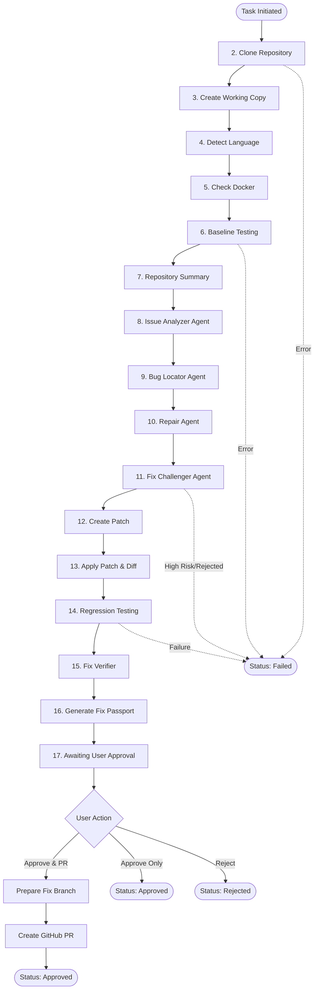

# YuktiCoreX Workflow & Task Lifecycle Specification

This document details the automated bug detection, repair, verification, and pull request workflow implemented in `Agent-Yukti-Corex/core/workflow.py`.

---

## 1. Architecture & Workflow Overview

YuktiCoreX uses a multi-agent, sandbox-verified automated pipeline to clone repositories, isolate changes in separate working copies, detect bugs via LLM agents, challenge and validate candidate patches, test them inside isolated Docker containers, and submit verified Pull Requests upon user approval.



---

## 2. Pipeline Execution Stages

### Stage 2: Clone Repository (`cloning_repository`)
- **Component**: `github.repo_manager.clone_repository`
- **Actions**:
  - Clones the target GitHub repository into an isolated cache directory.
  - Resolves repository path and validates directory integrity.
  - Captures `repository_path`, `default_branch`, and `commit_sha`.
- **Validation**:
  - Raises `REPOSITORY_CLONE_FAILED` if repository path or default branch is missing, or directory does not exist.

### Stage 3: Create Separate Working Copy
- **Component**: `github.repo_manager.create_working_copy`
- **Actions**:
  - Clones or copies the repository into a separate `workspace_path` specific to the `task_id`.
- **Safety Invariant**:
  - `workspace_path != repository_path` ensures the original base repository is never modified directly.

### Stage 4: Detect Programming Language (`detecting_language`)
- **Component**: `languages.language_detector.detect_language`
- **Actions**:
  - Inspects workspace files to identify primary language (e.g., Python, Java, JavaScript).
  - Validates language adapter support and updates the task state.

### Stage 5: Check Docker Daemon
- **Component**: `sandbox.docker_manager.check_docker_connection`
- **Actions**:
  - Validates that Docker Desktop / Docker Engine is running and responsive.
- **Validation**:
  - Raises `DOCKER_UNAVAILABLE` if daemon connectivity fails.

### Stage 6: Baseline Testing (`baseline_testing`)
- **Component**: `verification.baseline.run_baseline_tests`
- **Actions**:
  - Runs existing test suite inside Docker sandbox on clean workspace code.
  - Establishes a baseline for current passing/failing tests.
- **Validation**:
  - Fails if test status is `"error"` or `"not_run"` (`BASELINE_TEST_FAILED`).

### Stage 7: Prepare Repository Summary
- **Component**: `_repository_summary(repository_path)`
- **Actions**:
  - Extracts structural tree, key modules, file manifests, and dependencies for AI context window.

### Stage 8: Issue Analyzer Agent (`analyzing_issue`)
- **Component**: `agents.issue_analyzer.analyze_issue_for_backend`
- **Actions**:
  - Interprets GitHub issue title, body, logs, and stack traces against repository context.
  - Generates structured problem summary and requirements.
- **Validation**:
  - Requires `problem_summary` in agent response (`AI_INVALID_RESPONSE`).

### Stage 9: Bug Locator Agent (`locating_bug`)
- **Component**: `agents.bug_locator.locate_bug_for_backend`
- **Actions**:
  - Identifies culprit source file (`file_path`), target function/block (`function_name`), and root cause analysis (`reason`).

### Stage 10: Repair Agent (`generating_fix`)
- **Component**: `agents.repair_agent.propose_fix_for_backend`
- **Actions**:
  - Generates candidate fix containing `original_code`, `modified_code`, and `file_path`.
  - Validates syntax and alignment with bug location.

### Stage 11: Fix Challenger Agent (`challenging_fix`)
- **Component**: `agents.fix_challenger.challenge_fix_for_backend`
- **Actions**:
  - Adversarial review of proposed fix for unintended side-effects, syntax regressions, and security flaws.
  - Assigns risk level: `low`, `medium`, or `high`.
- **Validation**:
  - Must be explicitly approved (`approved == True`).
  - High-risk fixes are immediately rejected (`PATCH_INVALID`).

### Stage 12: Create Patch (`applying_patch`)
- **Component**: `core.patch_manager.create_patch`
- **Actions**:
  - Generates unified diff patch from `original_code` and `modified_code`.
- **Safety Checks**:
  - Confirms original file contents on disk match `original_code` before applying.

### Stage 13: Apply Patch
- **Component**: `core.patch_manager.apply_patch` & `get_file_diff`
- **Actions**:
  - Applies patch directly to the task workspace.
  - Extracts real Git diff for transparency and auditing.

### Stage 14: Regression Testing (`regression_testing`)
- **Component**: `verification.regression.run_regression_tests`
- **Actions**:
  - Re-runs test suite in Docker container with patch applied.

### Stage 15: Fix Verification
- **Component**: `verification.verifier.verify_fix`
- **Actions**:
  - Compares baseline vs. regression test results.
  - Ensures previously passing tests still pass and targeted failure is resolved.
- **Validation**:
  - Both `verification["passed"]` and `regression_result["passed"]` must be `True`.

### Stage 16: Generate Fix Passport (`preparing_report`)
- **Component**: `reports.fix_passport.generate_fix_passport`
- **Actions**:
  - Compiles comprehensive audit trail report containing issue data, bug location, patch diff, test outcomes, and challenger evaluation.

### Stage 17: User Approval Gate
- **Status**: `awaiting_approval`
- **Stage**: `finished` (100% progress)
- **Message**: *"Fix verified. Waiting for your approval."*
- Halts execution until explicit human decision (`approve_fix` or `reject_fix`).

---

## 3. Post-Approval & Git Pull Request Lifecycle

### Dedicated Branch Creation (`_prepare_branch_for_pr`)
1. Validates working copy directory and Git worktree status (`git rev-parse --is-inside-work-tree`).
2. Creates an isolated branch: `yukticorex/fix-<task_id>`.
3. Stages **only** the repaired source file (`git add -- <file_path>`).
4. Verifies staging cache to prevent unintended file leakage.
5. Commits with message: `Fix: <issue_title>`.
6. Pushes branch upstream to `origin`.

### Pull Request Generation (`approve_fix`)
- Invokes `github.pull_request.create_pull_request`.
- Generates structured PR description:
  - Reference to source GitHub issue.
  - Detected programming language.
  - Verification metrics (Baseline & Regression status).
  - Bug summary explanation.
- Updates task state to `approved` and records `pull_request_url`.

### Fix Rejection (`reject_fix`)
- Transitions task status to `rejected`.
- Records user rejection rationale in task metadata.

---

## 4. API & Helper Reference

### `get_task_progress(task_id: str) -> dict`
Returns real-time task execution progress, stage, message, and error diagnostics.

```json
{
  "task_id": "c1f7a0...",
  "status": "awaiting_approval",
  "stage": "finished",
  "progress_percent": 100,
  "message": "Fix verified. Waiting for your approval.",
  "updated_at": "2026-11-11T14:45:00Z",
  "error": null
}
```

### `get_task_results(task_id: str) -> dict`
Returns full payload of verified fix including bug location, original and modified code, Git diff, challenger review, and test results.

### `approve_fix(task_id: str, create_pull_request: bool = True) -> dict`
Approves the fix and optionally opens a GitHub Pull Request.

### `reject_fix(task_id: str, reason: str = None) -> dict`
Rejects the proposed fix and marks task as `rejected`.

---

## 5. Source Code Implementation

```python
        clone_result = _call(
            "github.repo_manager",
            "clone_repository",
            repo_url,
            task_id
        )

        clone_result = _require_dict(
            clone_result,
            "Repository Manager"
        )

        repository_path = clone_result.get("repository_path")
        default_branch = clone_result.get("default_branch")

        if not repository_path or not default_branch:
            raise WorkflowError(
                "REPOSITORY_CLONE_FAILED",
                "Repository clone information is incomplete.",
                "Expected repository_path and default_branch.",
                "cloning_repository"
            )

        repository_path = str(Path(repository_path).resolve())

        if not Path(repository_path).is_dir():
            raise WorkflowError(
                "REPOSITORY_CLONE_FAILED",
                "Cloned repository directory does not exist.",
                repository_path,
                "cloning_repository"
            )

        _update_task(
            task_id,
            repository_path=repository_path,
            default_branch=default_branch,
            commit_sha=clone_result.get("commit_sha")
        )

        # ----------------------------------------------------
        # 3. CREATE SEPARATE WORKING COPY
        # ----------------------------------------------------

        working_result = _call(
            "github.repo_manager",
            "create_working_copy",
            repository_path,
            task_id
        )

        working_result = _require_dict(
            working_result,
            "Working Copy Manager"
        )

        workspace_path = working_result.get("workspace_path")

        if not workspace_path:
            raise WorkflowError(
                "INTERNAL_ERROR",
                "Working copy path was not returned.",
                str(working_result),
                "cloning_repository"
            )

        workspace_path = str(Path(workspace_path).resolve())

        if not Path(workspace_path).is_dir():
            raise WorkflowError(
                "INTERNAL_ERROR",
                "Working copy directory does not exist.",
                workspace_path,
                "cloning_repository"
            )

        if Path(workspace_path) == Path(repository_path):
            raise WorkflowError(
                "INTERNAL_ERROR",
                "Repository and workspace paths must be different.",
                "The original repository cannot be modified.",
                "cloning_repository"
            )

        _update_task(
            task_id,
            workspace_path=workspace_path
        )

        # ----------------------------------------------------
        # 4. DETECT PROGRAMMING LANGUAGE
        # ----------------------------------------------------

        _set_stage(
            task_id,
            "detecting_language",
            "Detecting repository programming language."
        )

        language = _call(
            "languages.language_detector",
            "detect_language",
            repository_path
        )

        language = _validate_language(language)

        _update_task(
            task_id,
            language=language
        )

        # ----------------------------------------------------
        # 5. CHECK DOCKER
        # ----------------------------------------------------

        docker_available = _call(
            "sandbox.docker_manager",
            "check_docker_connection"
        )

        if docker_available is not True:
            raise WorkflowError(
                "DOCKER_UNAVAILABLE",
                "Docker is not available.",
                "Start Docker Desktop and try again.",
                "baseline_testing"
            )

        # ----------------------------------------------------
        # 6. BASELINE TESTING
        # ----------------------------------------------------

        _set_stage(
            task_id,
            "baseline_testing",
            "Running baseline tests in Docker."
        )

        baseline_result = _call(
            "verification.baseline",
            "run_baseline_tests",
            workspace_path,
            language
        )

        baseline_result = _validate_test_result(
            baseline_result,
            "baseline_testing"
        )

        if baseline_result["test_status"] in {"error", "not_run"}:
            raise WorkflowError(
                "BASELINE_TEST_FAILED",
                "Baseline tests could not be executed.",
                baseline_result.get("logs", ""),
                "baseline_testing"
            )

        _update_task(
            task_id,
            baseline_result=baseline_result
        )

        # ----------------------------------------------------
        # 7. PREPARE REPOSITORY SUMMARY
        # ----------------------------------------------------

        repository_summary = _repository_summary(
            repository_path
        )

        # ----------------------------------------------------
        # 8. ISSUE ANALYZER
        # ----------------------------------------------------

        _set_stage(
            task_id,
            "analyzing_issue",
            "Issue Analyzer is analyzing the GitHub issue."
        )

        issue_analysis = _call(
            "agents.issue_analyzer",
            "analyze_issue_for_backend",
            issue,
            repository_summary
        )

        issue_analysis = _require_dict(
            issue_analysis,
            "Issue Analyzer"
        )

        if not issue_analysis.get("problem_summary"):
            raise WorkflowError(
                "AI_INVALID_RESPONSE",
                "Issue Analyzer returned incomplete information.",
                "Missing problem_summary.",
                "analyzing_issue"
            )

        _update_task(
            task_id,
            issue_analysis=issue_analysis
        )

        # ----------------------------------------------------
        # 9. BUG LOCATOR
        # ----------------------------------------------------

        _set_stage(
            task_id,
            "locating_bug",
            "Bug Locator is identifying the faulty code."
        )

        bug_location = _call(
            "agents.bug_locator",
            "locate_bug_for_backend",
            issue_analysis,
            _repository_summary(repository_path),
            language
        )

        bug_location = _validate_bug_location(
            bug_location
        )

        _update_task(
            task_id,
            bug_location=bug_location
        )

        # ----------------------------------------------------
        # 10. REPAIR AGENT
        # ----------------------------------------------------

        _set_stage(
            task_id,
            "generating_fix",
            "Repair Agent is generating a proposed fix."
        )

        proposed_fix = _call(
            "agents.repair_agent",
            "propose_fix_for_backend",
            bug_location,
            issue_analysis,
            _repository_summary(workspace_path)
        )

        proposed_fix = _validate_proposed_fix(
            proposed_fix,
            bug_location
        )

        _update_task(
            task_id,
            proposed_fix=proposed_fix
        )

        # ----------------------------------------------------
        # 11. FIX CHALLENGER
        # ----------------------------------------------------

        _set_stage(
            task_id,
            "challenging_fix",
            "Fix Challenger is reviewing the proposed fix."
        )

        challenger_review = _call(
            "agents.fix_challenger",
            "challenge_fix_for_backend",
            issue_analysis,
            bug_location,
            proposed_fix
        )

        challenger_review = _require_dict(
            challenger_review,
            "Fix Challenger"
        )

        allowed_risks = {
            "low",
            "medium",
            "high"
        }

        if (
            challenger_review.get("approved") is not True
            or challenger_review.get("risk_level") not in allowed_risks
        ):
            raise WorkflowError(
                "PATCH_INVALID",
                "Fix Challenger did not approve the proposed fix.",
                str(challenger_review),
                "challenging_fix"
            )

        if challenger_review.get("risk_level") == "high":
            raise WorkflowError(
                "PATCH_INVALID",
                "The proposed fix has a high risk level.",
                challenger_review.get("summary", ""),
                "challenging_fix"
            )

        _update_task(
            task_id,
            challenger_review=challenger_review
        )

        # ----------------------------------------------------
        # 12. CREATE PATCH
        # ----------------------------------------------------

        _set_stage(
            task_id,
            "applying_patch",
            "Validating the proposed code patch."
        )

        patch = _call(
            "core.patch_manager",
            "create_patch",
            workspace_path,
            proposed_fix["file_path"],
            proposed_fix["modified_code"]
        )

        patch = _require_dict(
            patch,
            "Patch Manager"
        )

        if not patch.get("success"):
            raise WorkflowError(
                "PATCH_INVALID",
                "Patch Manager could not create the patch.",
                str(patch.get("error")),
                "applying_patch"
            )

        if patch.get("original_code") != proposed_fix["original_code"]:
            raise WorkflowError(
                "PATCH_INVALID",
                "The original file changed before patch creation.",
                "The proposed fix does not match the current file.",
                "applying_patch"
            )

        if patch.get("file_path") != proposed_fix["file_path"]:
            raise WorkflowError(
                "PATCH_INVALID",
                "Patch file path does not match the proposed fix.",
                str(patch.get("file_path")),
                "applying_patch"
            )

        # ----------------------------------------------------
        # 13. APPLY PATCH
        # ----------------------------------------------------

        apply_result = _call(
            "core.patch_manager",
            "apply_patch",
            workspace_path,
            patch
        )

        apply_result = _require_dict(
            apply_result,
            "Patch Manager"
        )

        if not apply_result.get("success"):
            raise WorkflowError(
                "PATCH_APPLY_FAILED",
                "The proposed patch could not be applied.",
                str(apply_result.get("error")),
                "applying_patch"
            )

        # Get actual difference after applying the patch.
        diff_result = _call(
            "core.patch_manager",
            "get_file_diff",
            workspace_path,
            proposed_fix["file_path"]
        )

        diff_result = _require_dict(
            diff_result,
            "Patch Manager"
        )

        actual_diff = diff_result.get("diff", "")

        proposed_fix["diff"] = actual_diff

        _update_task(
            task_id,
            patch=patch,
            apply_result=apply_result,
            diff=actual_diff,
            proposed_fix=proposed_fix
        )

        # ----------------------------------------------------
        # 14. REGRESSION TESTING
        # ----------------------------------------------------

        _set_stage(
            task_id,
            "regression_testing",
            "Running regression tests in Docker."
        )

        regression_result = _call(
            "verification.regression",
            "run_regression_tests",
            workspace_path,
            language
        )

        regression_result = _validate_test_result(
            regression_result,
            "regression_testing"
        )

        _update_task(
            task_id,
            regression_result=regression_result
        )

        # ----------------------------------------------------
        # 15. VERIFY FIX
        # ----------------------------------------------------

        verification = _call(
            "verification.verifier",
            "verify_fix",
            baseline_result,
            regression_result
        )

        verification = _require_dict(
            verification,
            "Fix Verifier"
        )

        verification["baseline"] = baseline_result
        verification["regression"] = regression_result

        if (
            verification.get("passed") is not True
            or regression_result.get("passed") is not True
            or regression_result.get("test_status") != "passed"
        ):
            raise WorkflowError(
                "REGRESSION_TEST_FAILED",
                "The proposed fix did not pass verification.",
                regression_result.get("logs", ""),
                "regression_testing"
            )

        _update_task(
            task_id,
            verification=verification
        )

        # ----------------------------------------------------
        # 16. GENERATE FIX PASSPORT
        # ----------------------------------------------------

        _set_stage(
            task_id,
            "preparing_report",
            "Generating the Fix Passport report."
        )

        report_result = _call(
            "reports.fix_passport",
            "generate_fix_passport",
            task_id=task_id,
            issue=issue,
            bug_location=bug_location,
            proposed_fix=proposed_fix,
            verification=verification,
            challenger_review=challenger_review
        )

        report_result = _require_dict(
            report_result,
            "Fix Passport Generator"
        )

        if not report_result.get("success"):
            raise WorkflowError(
                "INTERNAL_ERROR",
                "Fix Passport generation failed.",
                str(report_result),
                "preparing_report"
            )

        # ----------------------------------------------------
        # 17. WAIT FOR USER APPROVAL
        # ----------------------------------------------------

        _update_task(
            task_id,
            status="awaiting_approval",
            stage="finished",
            progress_percent=100,
            message="Fix verified. Waiting for your approval.",
            report_result=report_result,
            pull_request_url=None,
            error=None
        )

    except WorkflowError as exc:

        logger.error(
            "Workflow failed at %s: %s",
            exc.stage,
            exc.message
        )

        _update_task(
            task_id,
            status="failed",
            stage=exc.stage,
            progress_percent=PROGRESS.get(exc.stage, 100),
            message=exc.message,
            error={
                "code": exc.code,
                "message": exc.message,
                "details": exc.details,
                "stage": exc.stage
            }
        )

    except Exception as exc:

        logger.exception("Unexpected workflow failure.")

        _update_task(
            task_id,
            status="failed",
            stage="finished",
            progress_percent=100,
            message="An unexpected workflow error occurred.",
            error={
                "code": "INTERNAL_ERROR",
                "message": "An unexpected workflow error occurred.",
                "details": str(exc),
                "stage": "finished"
            }
        )


# ============================================================
# GET TASK PROGRESS
# ============================================================

def get_task_progress(task_id: str) -> dict:
    task = _load_task(task_id)

    if task is None:
        return _error_response(
            task_id,
            "INVALID_INPUT",
            "Task was not found.",
            "Invalid task ID."
        )

    return {
        "task_id": task_id,
        "status": task.get("status", "pending"),
        "stage": task.get("stage", "queued"),
        "progress_percent": int(
            task.get(
                "progress_percent",
                PROGRESS.get(task.get("stage"), 0)
            )
        ),
        "message": task.get("message", ""),
        "updated_at": task.get("updated_at"),
        "error": task.get("error")
    }


# ============================================================
# GET TASK RESULTS
# ============================================================

def get_task_results(task_id: str) -> dict:
    task = _load_task(task_id)

    if task is None:
        return _error_response(
            task_id,
            "INVALID_INPUT",
            "Task was not found.",
            "Invalid task ID."
        )

    if task.get("status") == "failed":
        return {
            "task_id": task_id,
            "status": "failed",
            "message": task.get("message"),
            "error": task.get("error")
        }

    if task.get("status") != "awaiting_approval" and task.get("status") != "approved":
        return {
            "task_id": task_id,
            "status": task.get("status"),
            "message": task.get("message", "Results are not ready.")
        }

    issue = task.get("issue") or {}
    bug_location = task.get("bug_location") or {}
    proposed_fix = task.get("proposed_fix") or {}
    verification = task.get("verification") or {}

    return {
        "task_id": task_id,
        "status": task.get("status"),
        "language": task.get("language"),
        "bug_file": bug_location.get("file_path"),
        "bug_location": bug_location.get("function_name"),
        "bug_explanation": bug_location.get("reason"),
        "original_code": proposed_fix.get("original_code"),
        "modified_code": proposed_fix.get("modified_code"),
        "diff": task.get("diff", ""),
        "challenger_review": task.get("challenger_review"),
        "verification": {
            "baseline": verification.get("baseline"),
            "regression": verification.get("regression")
        },
        "pull_request_url": task.get("pull_request_url")
    }


# ============================================================
# PREPARE GIT BRANCH AFTER APPROVAL
# ============================================================

def _run_git_command(workspace_path, command):
    """
    Run Git commands without using shell=True.
    """

    result = subprocess.run(
        ["git"] + command,
        cwd=workspace_path,
        capture_output=True,
        text=True,
        timeout=120,
        check=False
    )

    if result.returncode != 0:
        raise WorkflowError(
            "PULL_REQUEST_FAILED",
            "Git operation failed.",
            result.stderr or result.stdout,
            "creating_pull_request"
        )

    return result.stdout.strip()


def _prepare_branch_for_pr(task):
    """
    Create a dedicated fix branch, commit only the fixed file,
    and push it to GitHub.
    """

    workspace_path = task.get("workspace_path")
    task_id = task["task_id"]
    file_path = task.get("bug_location", {}).get("file_path")
    default_branch = task.get("default_branch")

    if not workspace_path or not Path(workspace_path).is_dir():
        raise WorkflowError(
            "PULL_REQUEST_FAILED",
            "Working copy is unavailable.",
            str(workspace_path),
            "creating_pull_request"
        )

    if not file_path or not default_branch:
        raise WorkflowError(
            "PULL_REQUEST_FAILED",
            "Required Git information is missing.",
            "Expected file_path and default_branch.",
            "creating_pull_request"
        )

    # Confirm this is a Git working copy.
    _run_git_command(
        workspace_path,
        ["rev-parse", "--is-inside-work-tree"]
    )

    branch_name = "yukticorex/fix-{}".format(task_id)

    # Create a separate branch from the current workspace commit.
    _run_git_command(
        workspace_path,
        ["switch", "-c", branch_name]
    )

    # Stage only the repaired source file.
    _run_git_command(
        workspace_path,
        ["add", "--", file_path]
    )

    staged_files = _run_git_command(
        workspace_path,
        ["diff", "--cached", "--name-only"]
    )

    staged_list = [
        item.strip().replace("\\", "/")
        for item in staged_files.splitlines()
        if item.strip()
    ]

    if file_path.replace("\\", "/") not in staged_list:
        raise WorkflowError(
            "PULL_REQUEST_FAILED",
            "The repaired file was not staged.",
            staged_files,
            "creating_pull_request"
        )

    # Commit the repaired file.
    _run_git_command(
        workspace_path,
        [
            "commit",
            "-m",
            "Fix: {}".format(task.get("issue_title", "GitHub issue"))
        ]
    )

    # Push the dedicated branch.
    _run_git_command(
        workspace_path,
        [
            "push",
            "-u",
            "origin",
            branch_name
        ]
    )

    return branch_name, default_branch


# ============================================================
# APPROVE FIX AND CREATE PULL REQUEST
# ============================================================

def approve_fix(
    task_id: str,
    create_pull_request: bool = True
) -> dict:

    task = _load_task(task_id)

    if task is None:
        return _error_response(
            task_id,
            "INVALID_INPUT",
            "Task was not found.",
            "Invalid task ID."
        )

    if task.get("status") != "awaiting_approval":
        return _error_response(
            task_id,
            "APPROVAL_REQUIRED",
            "Task is not waiting for approval.",
            "Approval is allowed only for awaiting_approval tasks."
        )

    if not isinstance(create_pull_request, bool):
        return _error_response(
            task_id,
            "INVALID_INPUT",
            "create_pull_request must be Boolean.",
            "Expected true or false."
        )

    # Approval without creating a PR.
    if not create_pull_request:

        _update_task(
            task_id,
            status="approved",
            message="Fix approved. Pull Request was not requested."
        )

        return {
            "task_id": task_id,
            "status": "approved",
            "message": "Fix approved.",
            "pull_request_url": None
        }

    try:

        _set_stage(
            task_id,
            "creating_pull_request",
            "Preparing Git branch and creating Pull Request."
        )

        task = _load_task(task_id)

        source_branch, target_branch = _prepare_branch_for_pr(
            task
        )

        issue_title = task.get("issue_title") or "Bug fix"

        issue_url = (task.get("issue") or {}).get(
            "issue_url",
            ""
        )

        verification = task.get("verification") or {}

        body = (
            "## YuktiC-oreX Automated Fix\n\n"
            "This Pull Request contains a proposed fix "
            "generated and verified by YuktiC-oreX.\n\n"
            "### GitHub Issue\n"
            "{}\n\n"
            "### Detected Language\n"
            "{}\n\n"
            "### Verification\n"
            "- Baseline test status: {}\n"
            "- Regression test status: {}\n"
            "- Regression tests passed: {}\n\n"
            "### Bug Summary\n"
            "{}\n\n"
            "The fix was approved by the user. "
            "This Pull Request has not been merged automatically."
        ).format(
            issue_url or "Issue #{}".format(task["issue_number"]),
            task.get("language", "unknown"),
            (verification.get("baseline") or {}).get("test_status"),
            (verification.get("regression") or {}).get("test_status"),
            (verification.get("regression") or {}).get("passed"),
            (task.get("bug_location") or {}).get("reason", "")
        )

        pr_result = _call(
            "github.pull_request",
            "create_pull_request",
            task["repo_url"],
            source_branch,
            target_branch,
            "Fix: {}".format(issue_title),
            body
        )

        pr_result = _require_dict(
            pr_result,
            "GitHub Pull Request"
        )

        if pr_result.get("created") is not True:
            raise WorkflowError(
                "PULL_REQUEST_FAILED",
                "GitHub Pull Request could not be created.",
                str(pr_result),
                "creating_pull_request"
            )

        pull_request_url = pr_result.get("pull_request_url")

        if not pull_request_url:
            raise WorkflowError(
                "PULL_REQUEST_FAILED",
                "Pull Request URL was not returned.",
                str(pr_result),
                "creating_pull_request"
            )

        _update_task(
            task_id,
            status="approved",
            stage="finished",
            progress_percent=100,
            message="Fix approved and Pull Request created.",
            source_branch=source_branch,
            target_branch=target_branch,
            pull_request_url=pull_request_url,
            pull_request_number=pr_result.get("pull_request_number"),
            error=None
        )

        return {
            "task_id": task_id,
            "status": "approved",
            "message": "Fix approved.",
            "pull_request_url": pull_request_url
        }

    except WorkflowError as exc:

        _update_task(
            task_id,
            status="failed",
            stage=exc.stage,
            message=exc.message,
            error={
                "code": exc.code,
                "message": exc.message,
                "details": exc.details,
                "stage": exc.stage
            }
        )

        return _error_response(
            task_id,
            exc.code,
            exc.message,
            exc.details,
            exc.stage
        )

    except Exception as exc:

        logger.exception("Pull Request creation failed.")

        _update_task(
            task_id,
            status="failed",
            stage="creating_pull_request",
            message="Pull Request creation failed.",
            error={
                "code": "PULL_REQUEST_FAILED",
                "message": "Pull Request creation failed.",
                "details": str(exc),
                "stage": "creating_pull_request"
            }
        )

        return _error_response(
            task_id,
            "PULL_REQUEST_FAILED",
            "Pull Request creation failed.",
            str(exc),
            "creating_pull_request"
        )


# ============================================================
# REJECT PROPOSED FIX
# ============================================================

def reject_fix(
    task_id: str,
    reason: str = None
) -> dict:

    task = _load_task(task_id)

    if task is None:
        return _error_response(
            task_id,
            "INVALID_INPUT",
            "Task was not found.",
            "Invalid task ID."
        )

    if task.get("status") != "awaiting_approval":
        return _error_response(
            task_id,
            "APPROVAL_REQUIRED",
            "Task is not waiting for approval.",
            "Only awaiting_approval tasks can be rejected."
        )

    if reason is not None and not isinstance(reason, str):
        return _error_response(
            task_id,
            "INVALID_INPUT",
            "Rejection reason must be a string.",
            "Invalid reason value."
        )

    _update_task(
        task_id,
        status="rejected",
        stage="finished",
        progress_percent=100,
        message="Proposed fix rejected.",
        rejection_reason=reason,
        error=None
    )

    return {
        "task_id": task_id,
        "status": "rejected",
        "message": "Proposed fix rejected."
    }
```
